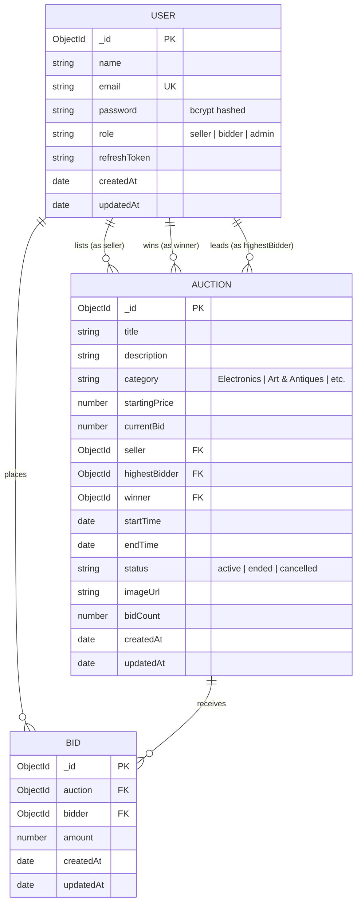

# BidZone – Database Architecture & Entity Relationship (ER) Diagram

## 1. Entity-Relationship (ER) Diagram



---

## 2. Collections & Field Specifications

### 2.1 `users` Collection
| Field | Type | Constraints / Validation | Description |
|---|---|---|---|
| `_id` | `ObjectId` | Primary Key, Auto-generated | Unique user identifier |
| `name` | `String` | Required, Trim, Length: 2–50 | Full display name |
| `email` | `String` | Required, Unique, Lowercase, Regex validated | Login email address |
| `password` | `String` | Required, Min length: 6, `select: false` | Bcrypt hashed password (10 salt rounds) |
| `role` | `String` | Enum: `['seller', 'bidder', 'admin']`, Default: `'bidder'` | RBAC authorization role |
| `refreshToken`| `String` | Optional, `select: false` | Active rotating JWT refresh token |
| `createdAt` | `Date` | Timestamp, Auto-generated | Account registration timestamp |
| `updatedAt` | `Date` | Timestamp, Auto-generated | Last account update timestamp |

**Indexes:**
- `{ email: 1 }` (Unique index for high-speed login and collision prevention)

---

### 2.2 `auctions` Collection
| Field | Type | Constraints / Validation | Description |
|---|---|---|---|
| `_id` | `ObjectId` | Primary Key, Auto-generated | Unique auction identifier |
| `title` | `String` | Required, Trim, Length: 3–100 | Auction item headline |
| `description` | `String` | Required, Trim, Length: 10–3000 | Item description |
| `category` | `String` | Required, Enum of 7 categories | Item category |
| `startingPrice`| `Number` | Required, Min: 1 | Base minimum opening bid |
| `currentBid` | `Number` | Required, Default: `startingPrice` | Highest bid amount placed |
| `highestBidder`| `ObjectId` | Ref: `User`, Default: `null` | Current leading bidder |
| `seller` | `ObjectId` | Required, Ref: `User` | User who created the auction listing |
| `startTime` | `Date` | Default: `Date.now` | Listing launch time |
| `endTime` | `Date` | Required, Validator: `endTime > startTime` | Auction conclusion timestamp |
| `status` | `String` | Enum: `['active', 'ended', 'cancelled']`, Default: `'active'` | Live state of the auction |
| `winner` | `ObjectId` | Ref: `User`, Default: `null` | User awarded item upon completion |
| `imageUrl` | `String` | Trim, URL or placeholder | High-resolution image link |
| `bidCount` | `Number` | Min: 0, Default: 0 | Total count of validated bids |
| `createdAt` | `Date` | Timestamp, Auto-generated | Creation timestamp |
| `updatedAt` | `Date` | Timestamp, Auto-generated | Last updated timestamp |

**Indexes:**
- `{ category: 1, status: 1 }` (Compound index for category filtering of active listings)
- `{ endTime: 1, status: 1 }` (Compound index for automated timer expiration queries)
- `{ seller: 1, createdAt: -1 }` (Compound index for seller dashboard item retrieval)
- `{ currentBid: 1 }` (Index for price sorting and range filtering)

---

### 2.3 `bids` Collection
| Field | Type | Constraints / Validation | Description |
|---|---|---|---|
| `_id` | `ObjectId` | Primary Key, Auto-generated | Unique bid identifier |
| `auction` | `ObjectId` | Required, Ref: `Auction` | Target auction listing |
| `bidder` | `ObjectId` | Required, Ref: `User` | User placing the bid |
| `amount` | `Number` | Required, Min: 1, Must exceed current highest | Bid offer value in USD |
| `createdAt` | `Date` | Timestamp, Auto-generated | Timestamp when bid was registered |
| `updatedAt` | `Date` | Timestamp, Auto-generated | Last update timestamp |

**Indexes:**
- `{ auction: 1, amount: -1 }` (Compound index for instant retrieval of highest bids per auction)
- `{ bidder: 1, createdAt: -1 }` (Compound index for bidder profile history)
- `{ auction: 1, createdAt: -1 }` (Compound index for live bid feed timeline)

---

## 3. Relationships & Referential Integrity
1. **User (Seller) to Auction (1-to-Many)**:
   - Stored as `Auction.seller` (`ObjectId` reference to `User`).
   - Cascade safety: Removing an auction purges related bids in `bids` collection.
2. **User (Bidder) to Bid (1-to-Many)**:
   - Stored as `Bid.bidder` (`ObjectId` reference to `User`).
3. **Auction to Bid (1-to-Many)**:
   - Stored as `Bid.auction` (`ObjectId` reference to `Auction`).
4. **Auction to User (Highest Bidder / Winner)**:
   - Referenced dynamically in `Auction.highestBidder` and resolved upon completion to `Auction.winner`.

---

## 4. Aggregation Pipelines

### 4.1 Category Sales Analytics (`GET /api/auctions/analytics/category-sales`)
```javascript
[
  {
    $group: {
      _id: '$category',
      totalListings: { $sum: 1 },
      activeListings: { $sum: { $cond: [{ $eq: ['$status', 'active'] }, 1, 0] } },
      endedListings: { $sum: { $cond: [{ $eq: ['$status', 'ended'] }, 1, 0] } },
      totalSalesRevenue: {
        $sum: {
          $cond: [
            { $and: [{ $eq: ['$status', 'ended'] }, { $ne: ['$highestBidder', null] }] },
            '$currentBid',
            0
          ]
        }
      },
      averageCurrentBid: { $avg: '$currentBid' },
      highestBidRecorded: { $max: '$currentBid' },
      totalBidsSum: { $sum: '$bidCount' }
    }
  },
  {
    $project: {
      category: '$_id',
      _id: 0,
      totalListings: 1,
      activeListings: 1,
      endedListings: 1,
      totalSalesRevenue: { $round: ['$totalSalesRevenue', 2] },
      averageCurrentBid: { $round: ['$averageCurrentBid', 2] },
      highestBidRecorded: 1,
      totalBidsSum: 1
    }
  },
  { $sort: { totalSalesRevenue: -1, totalListings: -1 } }
]
```

### 4.2 Top Bidders Leaderboard (`GET /api/users/leaderboard`)
```javascript
[
  {
    $group: {
      _id: '$bidder',
      totalBidsCount: { $sum: 1 },
      highestSingleBid: { $max: '$amount' },
      totalBidVolume: { $sum: '$amount' }
    }
  },
  {
    $lookup: {
      from: 'users',
      localField: '_id',
      foreignField: '_id',
      as: 'user'
    }
  },
  { $unwind: '$user' },
  {
    $project: {
      userId: '$_id',
      _id: 0,
      name: '$user.name',
      email: '$user.email',
      totalBidsCount: 1,
      highestSingleBid: 1,
      totalBidVolume: 1
    }
  },
  { $sort: { totalBidsCount: -1 } },
  { $limit: 10 }
]
```
